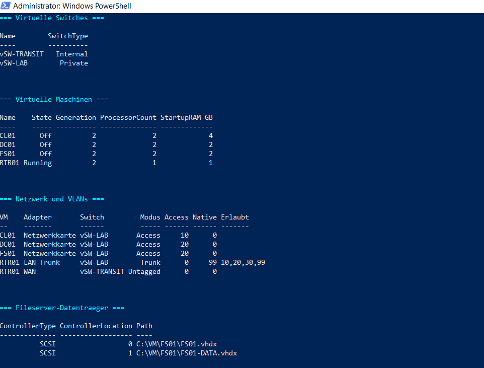
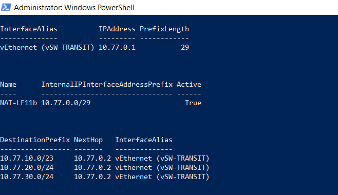

# Virtuelle Infrastruktur bereitstellen

## Ziel

Bereitstellung der virtuellen Netzbasis und der vier geplanten Systeme in Hyper-V.

## Virtuelle Switches

| Name | Typ | Funktion |
|---|---|---|
| `vSW-TRANSIT` | Internal | Verbindung zwischen Hyper-V-Host und `RTR01` |
| `vSW-LAB` | Private | Isolierte Verbindung der Lab-Systeme |

## Virtuelle Maschinen

| VM | Generation | vCPU | Start-RAM | Systemdatenträger | Netzwerk |
|---|---:|---:|---:|---:|---|
| `RTR01` | 2 | 1 | 1 GB | 20 GB | WAN und LAN-Trunk |
| `DC01` | 2 | 2 | 2 GB | 60 GB | Access-VLAN 20 |
| `FS01` | 2 | 2 | 2 GB | 60 GB | Access-VLAN 20 |
| `CL01` | 2 | 2 | 4 GB | 80 GB | Access-VLAN 10 |

Für `FS01` wurde zusätzlich eine dynamisch wachsende Daten-VHDX mit 80 GB angebunden. Der Datenträger wurde noch nicht initialisiert oder formatiert.

## VLAN-Zuordnung

| System | Adapter | Modus | VLANs |
|---|---|---|---|
| `RTR01` | `WAN` | Untagged | Transitnetz |
| `RTR01` | `LAN-Trunk` | Trunk | Tagged: 10, 20, 30; Native/Parking: 99 |
| `DC01` | Netzwerkkarte | Access | 20 |
| `FS01` | Netzwerkkarte | Access | 20 |
| `CL01` | Netzwerkkarte | Access | 10 |

## Hyper-V-Netzbasis

| Einstellung | Wert |
|---|---|
| Transit-IP des Hosts | `10.77.0.1/29` |
| Router im Transitnetz | `10.77.0.2/29` |
| Windows-NAT | `NAT-LF11b` |
| NAT-Präfix | `10.77.0.0/29` |
| Clientroute | `10.77.10.0/23` über `10.77.0.2` |
| Serverroute | `10.77.20.0/24` über `10.77.0.2` |
| Erweiterungsroute | `10.77.30.0/24` über `10.77.0.2` |

## Nachweise

### Virtuelle Systeme und VLANs

### Transit, NAT und Hostrouten

## Ergebnis

Die beiden virtuellen Switches und alle vier VMs sind vorhanden. Die Netzwerkadapter sind den vorgesehenen Access-VLANs beziehungsweise dem Router-Trunk zugeordnet. Transit-IP, Windows-NAT und Hostrouten sind aktiv. Die zusätzliche Daten-VHDX des Fileservers ist ausschließlich angebunden.
