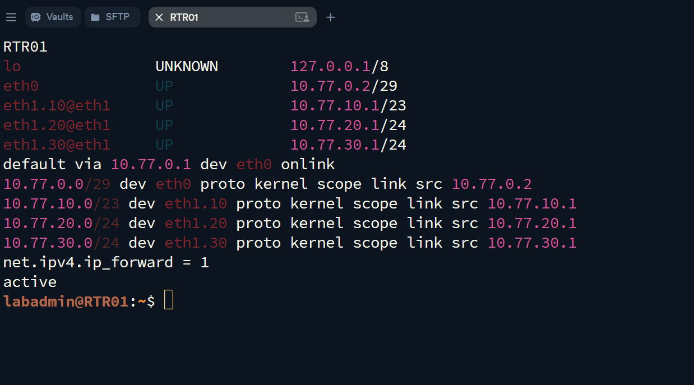
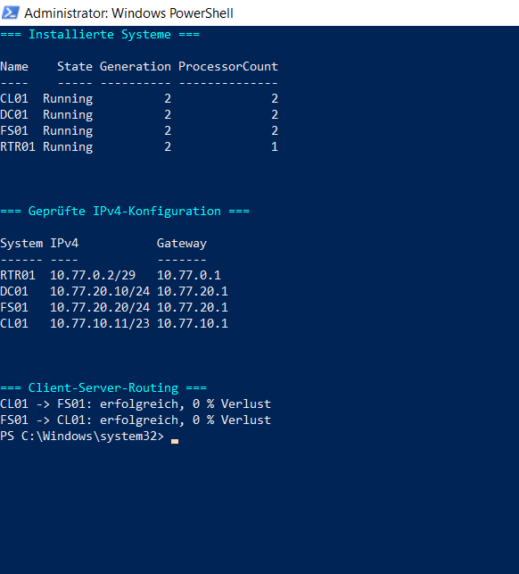

# Systeme installieren und grundkonfigurieren

## Ziel

Installation und Grundkonfiguration der vier Systeme mit den geplanten Hostnamen, IPv4-Adressen und Gateways.

## Systemkonfiguration

| System | Betriebssystem | Hostname | IPv4-Adresse | Gateway | DNS |
|---|---|---|---|---|---|
| Router | Debian 13 | `RTR01` | `10.77.0.2/29` | `10.77.0.1` | `10.100.0.1` |
| Domaincontroller | Windows Server 2025 | `DC01` | `10.77.20.10/24` | `10.77.20.1` | `10.77.20.10` |
| Fileserver | Windows Server 2025 | `FS01` | `10.77.20.20/24` | `10.77.20.1` | `10.77.20.10` |
| Client | Windows 11 Pro | `CL01` | `10.77.10.11/23` | `10.77.10.1` | `10.77.20.10` |

## Router-Konfiguration

Der Debian-Router wurde ohne Desktop-Umgebung installiert. Der Benutzer `labadmin` wurde für die Administration mit `sudo` vorbereitet.

| Schnittstelle | Funktion | Adresse |
|---|---|---|
| `eth0` | WAN / Transit | `10.77.0.2/29` |
| `eth1.10` | Clientnetz, VLAN 10 | `10.77.10.1/23` |
| `eth1.20` | Servernetz, VLAN 20 | `10.77.20.1/24` |
| `eth1.30` | reserviertes Erweiterungsnetz, VLAN 30 | `10.77.30.1/24` |

Die Router-Grundkonfiguration umfasst:

- 802.1Q-VLAN-Unterinterfaces
- IPv4-Forwarding
- `nftables`
- Masquerading der internen Netze über `eth0`
- persistente Netzwerkkonfiguration

## Fileserver-Datenträger

| Datenträger | Größe | Zustand |
|---|---:|---|
| System-VHDX | 60 GB | GPT, Windows-Systemdatenträger |
| Daten-VHDX | 80 GB | RAW, nur angebunden |

Die Daten-VHDX wurde nicht initialisiert und nicht formatiert.

## Routing-Prüfung

| Richtung | Ergebnis |
|---|---|
| `CL01` → `FS01` | erfolgreich, 0 % Verlust |
| `FS01` → `CL01` | erfolgreich, 0 % Verlust |

Die Kommunikation zwischen Clientnetz und Servernetz erfolgt über `RTR01`. Für die ICMP-Prüfung wurden auf den Windows-Systemen gezielte Firewallregeln für das jeweils andere Lab-Netz verwendet. Die Windows-Firewall blieb aktiviert.

## Nachweise

### Router-Netzwerkstatus

### Installierte Systeme und Routing

## Ergebnis

Alle vier Betriebssysteme sind installiert. Hostnamen, IPv4-Adressen und Gateways entsprechen der Planung. Die Router-Skripte wurden ohne offenen Fehler ausgeführt. IPv4-Forwarding und `nftables` sind aktiv. Das Routing zwischen Client- und Servernetz wurde in beiden Richtungen erfolgreich geprüft.
