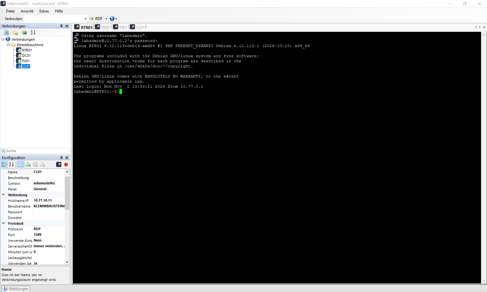

# Domäne und Verwaltungszugänge integrieren

## Ziel

Bereitstellung der Domäne `klemmbausteine.intern`, Einrichtung der DNS-Basis, Aufnahme von Fileserver und Client sowie Prüfung der administrativen Zugänge.

## Active Directory

| Einstellung | Wert |
|---|---|
| Forest | `klemmbausteine.intern` |
| Domäne | `klemmbausteine.intern` |
| NetBIOS-Name | `KLEMMBAUSTEINE` |
| Domaincontroller | `DC01.klemmbausteine.intern` |
| DC-Adresse | `10.77.20.10` |
| Funktionsebenen | Windows Server 2025 |
| Global Catalog | aktiv |

Die Dienste `ADWS`, `DNS` und `Netlogon` wurden mit Starttyp `Automatic` und Status `Running` geprüft.

## DNS-Basis

| Einstellung | Wert |
|---|---|
| DNS-Server | `10.77.20.10` |
| Forwarder | `10.100.0.1` |
| Forward-Lookup-Zone | `klemmbausteine.intern` |
| Reverse-Zone Client 1 | `10.77.10.0/24` |
| Reverse-Zone Client 2 | `10.77.11.0/24` |
| Reverse-Zone Server | `10.77.20.0/24` |
| Reverse-Zone Erweiterung | `10.77.30.0/24` |

Das Clientnetz `10.77.10.0/23` wird durch zwei `/24`-Reverse-Zonen abgedeckt. Hostauflösung, AD-SRV-Auflösung und externe DNS-Auflösung wurden erfolgreich geprüft.

## Domänenmitglieder

| System | Domäne | Secure Channel | Anmeldung |
|---|---|---|---|
| `FS01` | `klemmbausteine.intern` | erfolgreich | `KLEMMBAUSTEINE\Administrator` |
| `CL01` | `klemmbausteine.intern` | erfolgreich | `KLEMMBAUSTEINE\Administrator` |

Für beide Systeme wurde `PartOfDomain = True` bestätigt. `Test-ComputerSecureChannel` lieferte jeweils `True`.

## Verwaltungszugänge

| Ziel | Protokoll | Adresse | Ergebnis |
|---|---|---|---|
| `RTR01` | SSH2 | `10.77.0.2:22` | erfolgreich |
| `DC01` | RDP | `10.77.20.10:3389` | erfolgreich |
| `FS01` | RDP | `10.77.20.20:3389` | erfolgreich |
| `CL01` | RDP | `10.77.10.11:3389` | erfolgreich |

Die RDP-Zugänge wurden über gezielt aktivierte Remotedesktop-Regeln der Windows-Firewall bereitgestellt. Die Verbindungen wurden in mRemoteNG im Ordner `Klemmbausteine` angelegt und getestet. Passwörter wurden nicht dokumentiert.

## Nachweis

### Verwaltungszugänge in mRemoteNG

## Ergebnis

Die Domäne und die DNS-Basis funktionieren. Das DNS-Skript wurde ohne offenen Fehler ausgeführt. `FS01` und `CL01` sind Mitglieder der Domäne. SSH- und RDP-Verwaltungszugänge wurden erfolgreich getestet.
