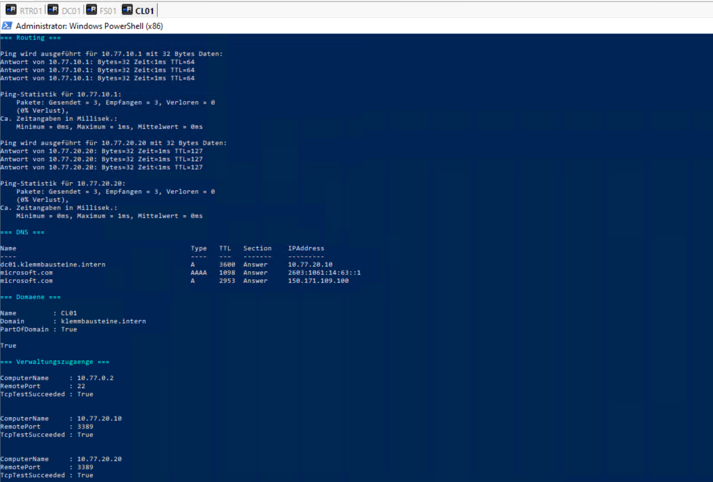
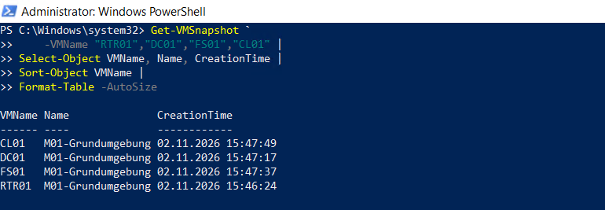

# Grundumgebung prüfen und M01 sichern

## Ziel

Prüfung der grundlegenden Funktionen und Sicherung des geprüften Zustands als Meilenstein `M01-Grundumgebung`.

## Kernprüfungen

| Prüfung | Ziel | Ergebnis |
|---|---|---|
| Client-Gateway | `10.77.10.1` | erfolgreich, 0 % Verlust |
| Client zu Fileserver | `10.77.20.20` | erfolgreich, 0 % Verlust |
| Interne DNS-Auflösung | `dc01.klemmbausteine.intern` → `10.77.20.10` | erfolgreich |
| Externe DNS-Auflösung | `microsoft.com` | erfolgreich |
| Domänenmitgliedschaft | `CL01` in `klemmbausteine.intern` | bestätigt |
| Secure Channel | `CL01` zur Domäne | gültig |
| SSH-Verbindung | `RTR01`, TCP 22 | erfolgreich |
| RDP-Verbindung | `DC01`, TCP 3389 | erfolgreich |
| RDP-Verbindung | `FS01`, TCP 3389 | erfolgreich |

## Verwaltungszugänge

Die zuvor eingerichteten Verbindungen wurden über mRemoteNG geprüft:

- `RTR01` über SSH2
- `DC01` über RDP
- `FS01` über RDP
- `CL01` über RDP

## Meilenstein

Für alle vier virtuellen Maschinen wurde ein Checkpoint mit dem Namen `M01-Grundumgebung` erstellt:

| VM | Checkpoint |
|---|---|
| `RTR01` | `M01-Grundumgebung` |
| `DC01` | `M01-Grundumgebung` |
| `FS01` | `M01-Grundumgebung` |
| `CL01` | `M01-Grundumgebung` |

## Nachweise

### Kernprüfungen

### M01-Grundumgebung

## Ergebnis

Routing, interne und externe Namensauflösung, Domänenanmeldung sowie SSH- und RDP-Verwaltungszugänge funktionieren. Die Kernprüfungen wurden ohne offenen Fehler abgeschlossen. Der geprüfte Zustand ist für alle vier VMs als `M01-Grundumgebung` gesichert. Zusätzliche Baseline- oder Härtungsmaßnahmen wurden nicht vorgezogen.
