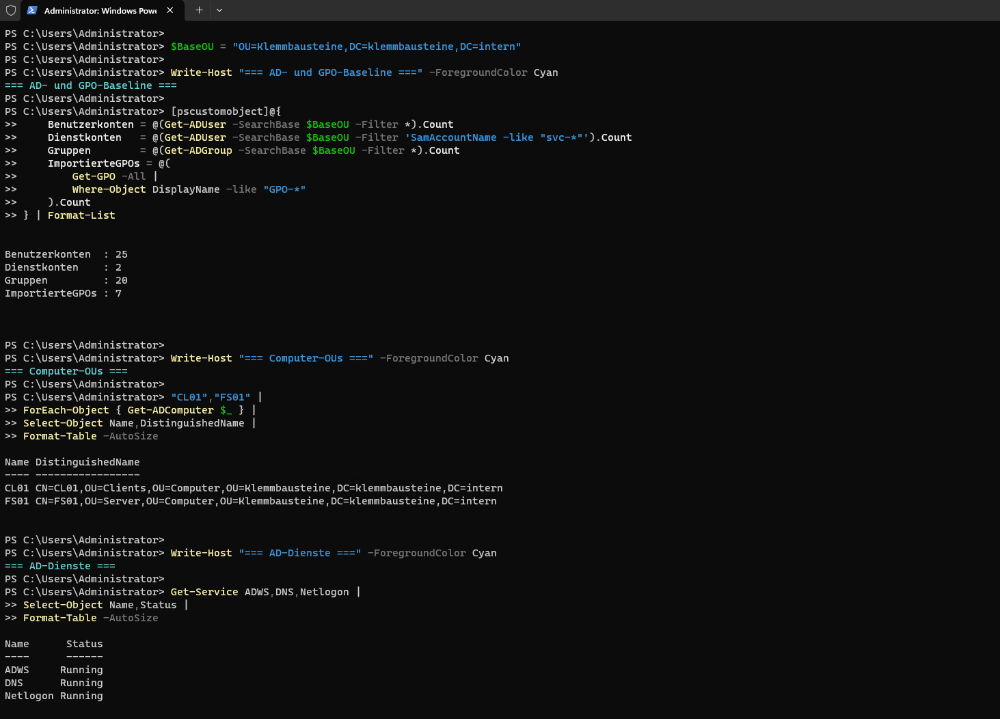
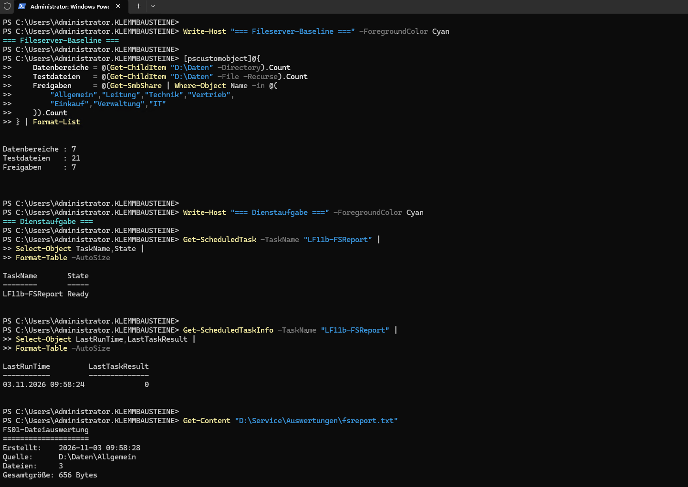
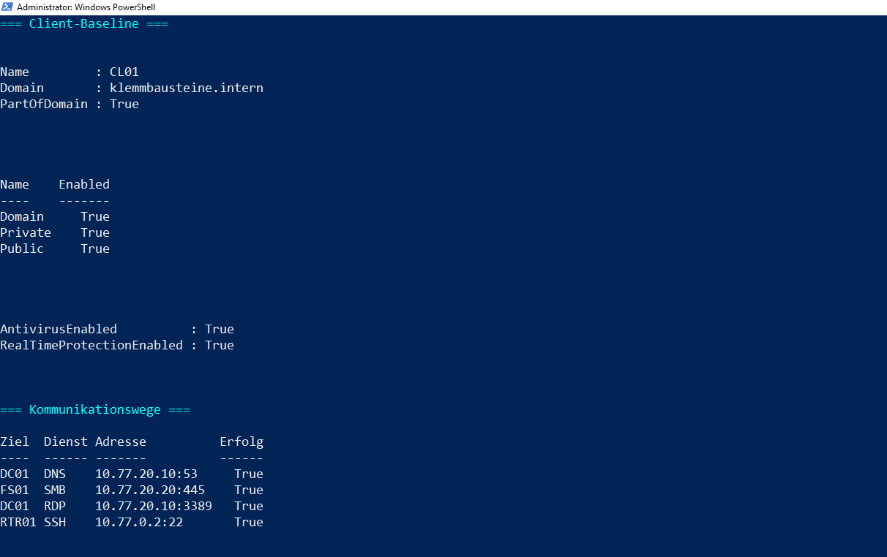

# Technische Legacy-Baseline

## Ziel

Bereitstellung und technische Prüfung des vorgesehenen Ausgangszustands für Active Directory, Gruppenrichtlinien, Fileserver, Client und Router.

## Active Directory und Gruppenrichtlinien

| Bereich | Ergebnis |
|---|---:|
| Benutzerkonten gesamt | 25 |
| davon Dienstkonten | 2 |
| Gruppen | 20 |
| importierte GPOs | 7 |
| GPO-Verknüpfungen | 8 |
| GPO-Delegationen | 1 |

`CL01` wurde nach `OU=Clients,OU=Computer` verschoben. `FS01` wurde nach `OU=Server,OU=Computer` verschoben. Die Client- und Serverrichtlinien wurden erfolgreich verarbeitet.

Die Dienste `ADWS`, `DNS` und `Netlogon` liefen ohne Fehler. Die Testkonten `tst-technik`, `tst-leitung` und `tst-ohnezugriff` sowie die Konten `admin`, `svc-fsreport` und `svc-backup` waren vorhanden und aktiviert.

## Fileserver-Baseline

| Bereich | Ergebnis |
|---|---:|
| Datenvolume | `D:` / NTFS / `DATEN` |
| Datenbereiche | 7 |
| Testdateien | 21 |
| SMB-Freigaben | 7 |
| Direkte Benutzerrechte | 2 |

Die NTFS-Berechtigungen wurden über die Gruppen `ACL-FS-*-R` und `ACL-FS-*-RW` umgesetzt. Ein erlaubter Zugriff mit `tst-technik` war erfolgreich. Ein nicht vorgesehener Zugriff mit `tst-ohnezugriff` wurde verweigert.

## Technische Dienstaufgabe

Die Aufgabe `LF11b-FSReport` wird mit `KLEMMBAUSTEINE\svc-fsreport` ausgeführt.

| Einstellung | Wert |
|---|---|
| Quelle | `D:\Daten\Allgemein` |
| Skript | `D:\Service\Scripts\fsreport.ps1` |
| Ausgabe | `D:\Service\Auswertungen\fsreport.txt` |
| Ausführungsrecht | Anmelden als Stapelverarbeitungsauftrag |
| Letztes Ergebnis | `0` |

Der Bericht enthielt drei Dateien aus dem Bereich `Allgemein` und wurde erfolgreich erzeugt.

## Client- und Routerzustand

`CL01` ist Mitglied der Domäne `klemmbausteine.intern`. Windows Firewall, Microsoft Defender und Echtzeitschutz waren aktiviert.

`RTR01` stellte die folgenden Netze bereit:

| Schnittstelle | Netz |
|---|---|
| `eth0` | `10.77.0.2/29` |
| `eth1.10` | `10.77.10.1/23` |
| `eth1.20` | `10.77.20.1/24` |
| `eth1.30` | `10.77.30.1/24` |

IPv4-Forwarding, `nftables`, NAT und SSH waren aktiv.

## Kommunikationsprüfung

| Verbindung | Dienst | Ergebnis |
|---|---|---|
| `CL01` → `DC01` | DNS, TCP 53 | erfolgreich |
| `CL01` → `FS01` | SMB, TCP 445 | erfolgreich |
| `CL01` → `DC01` | RDP, TCP 3389 | erfolgreich |
| `CL01` → `RTR01` | SSH, TCP 22 | erfolgreich |

Zusätzlich wurden nicht vorhandene DNS-Namen, ein ungültiger SMB-Pfad, ein nicht erreichbarer Testdienst, eine ungültige Domänenanmeldung und ein nicht erlaubter Fileserverzugriff erfolgreich abgelehnt.

## Nachweise

### AD- und GPO-Baseline

### Fileserver und Dienstaufgabe

### Client, Router und Kommunikation

## Meilenstein

Für folgende Systeme wurde der Checkpoint `M02-Legacy-Baseline` erstellt:

- `RTR01`
- `DC01`
- `FS01`
- `CL01`

Die technische Legacy-Baseline ist damit reproduzierbar gesichert. Unerwartete technische Fehler wurden korrigiert und anschließend erneut geprüft.
