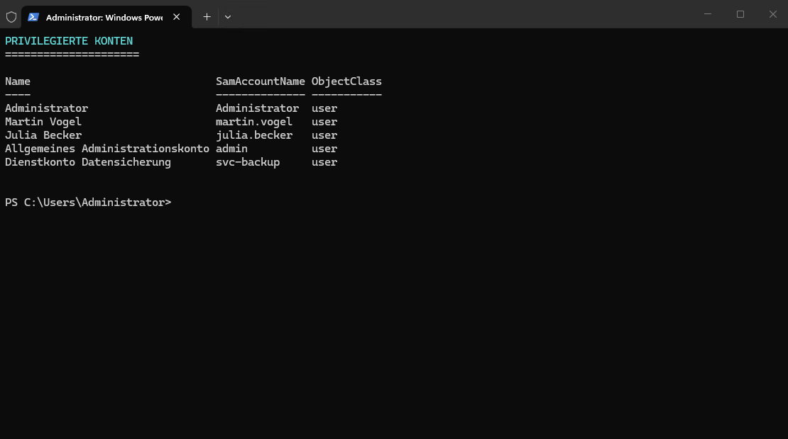
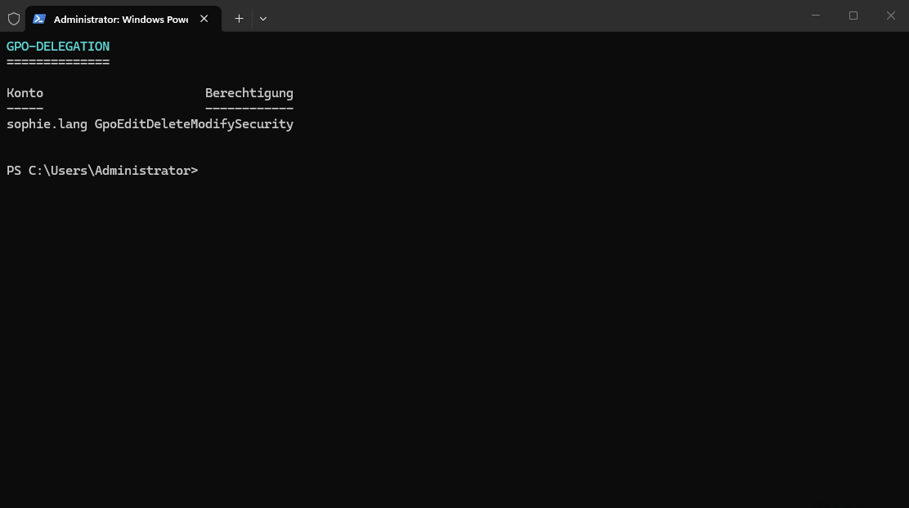
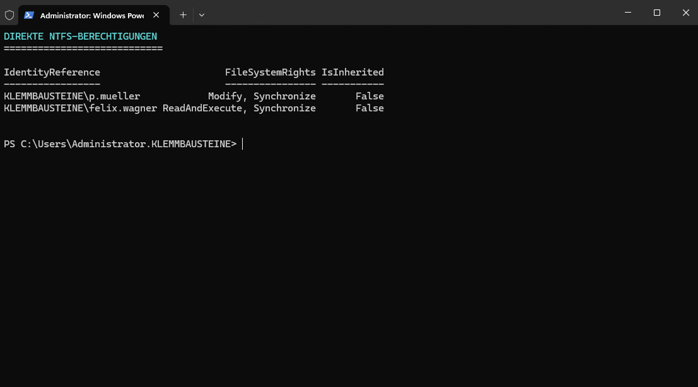

# Sicherheitsanalyse und Maßnahmenplanung

## Ausgangslage

Die Sicherheitsanalyse basiert auf dem gesicherten Zustand `M02-Legacy-Baseline`.

Ziel war die strukturierte Erfassung sicherheitsrelevanter Zustände, die Bewertung des Schutzbedarfs und der daraus resultierenden Risiken sowie die Planung geeigneter Sicherheitsmaßnahmen.

Die dokumentierte Legacy-Baseline wurde ausschließlich analysiert. Sicherheitsrelevante Änderungen oder Härtungsmaßnahmen wurden in diesem Arbeitsschritt nicht umgesetzt.

## Technische Findings

| ID  | Finding                                   | Betroffenes Objekt           | Beobachteter Zustand                                                                                                                       |
| --- | ----------------------------------------- | ---------------------------- | ------------------------------------------------------------------------------------------------------------------------------------------ |
| F01 | Erweiterte Domänen-Admin-Mitgliedschaften | Active Directory             | Neben dem integrierten Administrator sind `admin`, `martin.vogel`, `julia.becker` und `svc-backup` Mitglieder der Gruppe `Domänen-Admins`. |
| F02 | Privilegiertes Dienstkonto                | `svc-backup`                 | Das aktivierte Dienstkonto ist Mitglied der `Domänen-Admins` und verwendet ein nicht ablaufendes Kennwort.                                 |
| F03 | Nicht ablaufende Dienstkontenkennwörter   | `svc-backup`, `svc-fsreport` | Für beide Dienstkonten ist `PasswordNeverExpires` aktiviert.                                                                               |
| F04 | Ungeeignete Gruppenverschachtelung        | AD-Gruppen                   | Rollen- und Berechtigungsgruppen besitzen teilweise fachfremde oder gegenseitige Mitgliedschaften.                                         |
| F05 | Veraltete Gruppenmitgliedschaft           | `markus.weber`               | Das deaktivierte Benutzerkonto ist weiterhin Mitglied einer fachlichen Rollengruppe.                                                       |
| F06 | Direkte GPO-Delegation                    | `sophie.lang`                | Das Benutzerkonto besitzt `GpoEditDeleteModifySecurity` auf `GPO-BENUTZER-BASIS`.                                                          |
| F07 | Direkte NTFS-Berechtigungen               | `FS01`                       | `p.mueller` besitzt `Modify` auf `Vertrieb`. `felix.wagner` besitzt `ReadAndExecute` auf `Technik`.                                        |
| F08 | Gemeinsame Startkennwörter                | Benutzer- und Dienstkonten   | Mehrere Konten wurden mit gemeinsamen Startkennwörtern erstellt. Eine Kennwortänderung bei der ersten Anmeldung wurde nicht erzwungen.     |

## Technische Nachweise

### Privilegierte Konten



Die Gruppe `Domänen-Admins` enthält mehrere personenbezogene Konten sowie das Dienstkonto `svc-backup`.

### GPO-Delegation



Das Benutzerkonto `sophie.lang` besitzt direkte administrative Berechtigungen auf `GPO-BENUTZER-BASIS`.

### Direkte NTFS-Berechtigungen



Die Berechtigungen von `p.mueller` und `felix.wagner` wurden direkt auf den Fachordnern gesetzt.

`IsInherited = False` bestätigt, dass die Berechtigungen nicht von einem übergeordneten Ordner geerbt wurden.

## Schutzobjekte

| ID  | Schutzobjekt                           | Zweck und Funktion                                                          | Zugehörige Findings                  |
| --- | -------------------------------------- | --------------------------------------------------------------------------- | ------------------------------------ |
| S01 | Active Directory auf `DC01`            | Zentrale Verwaltung von Benutzern, Gruppen, Computern und Richtlinien       | F01, F02, F04, F05, F08              |
| S02 | DNS-Dienst auf `DC01`                  | Interne Namensauflösung und Ermittlung der Domänendienste                   | Abhängigkeit zu S01 und S05          |
| S03 | Identitäten und Berechtigungen         | Steuerung von Anmeldungen, Rollen, administrativen Rechten und Dienstkonten | F01 bis F08                          |
| S04 | Fachdaten und SMB-Freigaben auf `FS01` | Zentrale Bereitstellung der Daten der Unternehmensbereiche                  | F04, F05, F07                        |
| S05 | `RTR01` und Netzwerkkommunikation      | Routing zwischen Client-, Server-, Erweiterungs- und Transitnetz            | Abhängigkeit aller zentralen Dienste |

## Technische Abhängigkeiten

```text
CL01
└── DNS auf DC01
    └── Active Directory

CL01
└── RTR01
    └── FS01

FS01
└── Active Directory
    └── Rollen- und ACL-Gruppen

GPO-Verarbeitung
└── DC01 und SYSVOL
    ├── CL01
    └── FS01

Dienstkonten
└── Active Directory
    └── Dienste und geplante Aufgaben
```
