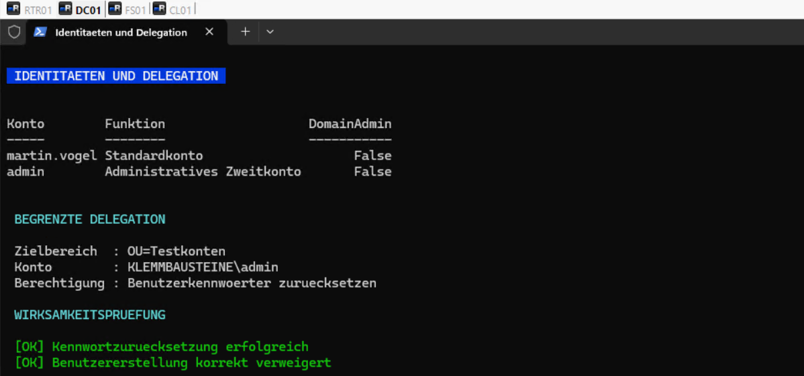
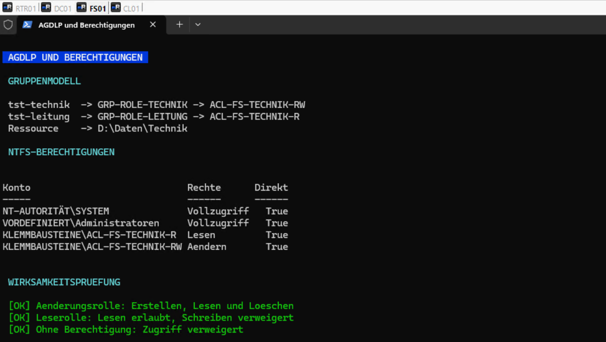
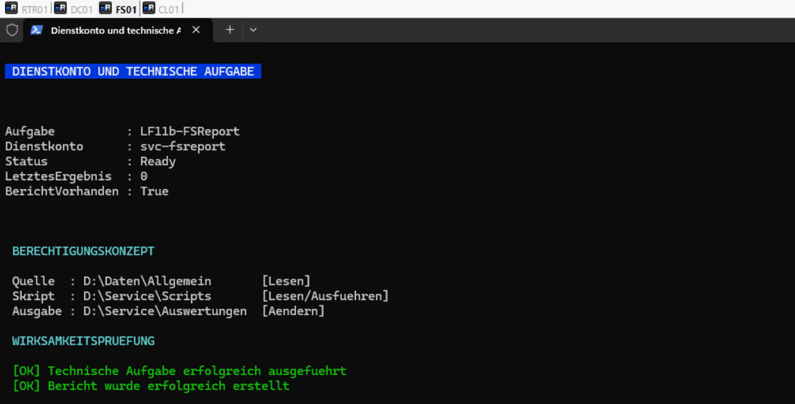

# Identitäten, Delegation und Berechtigungsmodell

## Zielsetzung

Die administrative Kontennutzung und die Zugriffssteuerung auf dem Fileserver wurden nach dem Prinzip der minimalen Rechte neu geordnet. Standardkonten, administrative Tätigkeiten, Rollenmitgliedschaften und Ressourcenzugriffe sind klar voneinander getrennt.

## Administrative Identitäten

Das Standardkonto `martin.vogel` und das administrative Zweitkonto `admin` wurden aus der Gruppe `Domänen-Admins` entfernt.

| Konto | Funktion | Domänen-Admin |
|---|---|---:|
| `martin.vogel` | Standardkonto für reguläre Tätigkeiten | Nein |
| `admin` | Administratives Zweitkonto für delegierte Aufgaben | Nein |

Das Konto `admin` erhielt ausschließlich eine begrenzte Delegation innerhalb der Organisationseinheit `OU=Testkonten`.

**Delegierte Berechtigung:**

```text
Benutzerkennwörter zurücksetzen
Änderung des Attributs pwdLastSet
```

**Wirksamkeitsprüfung:**

- Das Kennwort von `tst-technik` konnte erfolgreich zurückgesetzt werden.
- Das Erstellen eines neuen Benutzerkontos wurde mit `Zugriff verweigert` abgelehnt.



## Gruppen- und Berechtigungsmodell

Die Zugriffssteuerung für die Fachbereiche `Technik` und `Leitung` folgt dem Modell `AGDLP`:

```text
Account
→ Globale Rollengruppe
→ Domänenlokale ACL-Gruppe
→ Berechtigung auf der Ressource
```

### Bereich Technik

```text
tst-technik
→ GRP-ROLE-TECHNIK
→ ACL-FS-TECHNIK-RW
→ Ändern auf D:\Daten\Technik
```

```text
tst-leitung
→ GRP-ROLE-LEITUNG
→ ACL-FS-TECHNIK-R
→ Lesen auf D:\Daten\Technik
```

### Bereich Leitung

```text
tst-leitung
→ GRP-ROLE-LEITUNG
→ ACL-FS-LEITUNG-RW
→ Ändern auf D:\Daten\Leitung
```

Die fachfremde Mitgliedschaft `GRP-ROLE-VERWALTUNG → ACL-FS-LEITUNG-R` wurde entfernt. Die direkte NTFS-Berechtigung von `felix.wagner` auf `D:\Daten\Technik` wurde ebenfalls entfernt.

### Wirksamkeitsprüfung

| Testkonto | Erwartete Berechtigung | Ergebnis |
|---|---|---|
| `tst-technik` | Erstellen, Lesen, Ändern und Löschen | Erfolgreich |
| `tst-leitung` | Lesen, kein Schreibzugriff | Erfolgreich |
| `tst-ohnezugriff` | Kein Zugriff | Zugriff verweigert |



## Technisches Dienstkonto

Die technische Aufgabe `LF11b-FSReport` wird weiterhin mit dem Dienstkonto `svc-fsreport` ausgeführt. Die Berechtigungen bleiben auf die erforderlichen Pfade begrenzt.

| Bereich | Pfad | Berechtigung |
|---|---|---|
| Quelle | `D:\Daten\Allgemein` | Lesen und Ausführen |
| Skript | `D:\Service\Scripts` | Lesen und Ausführen |
| Ausgabe | `D:\Service\Auswertungen` | Ändern |

Die geplante Aufgabe wurde erneut ausgeführt und geprüft:

```text
Status: Ready
LastTaskResult: 0
Bericht vorhanden: True
```

Damit ist nachgewiesen, dass die Berechtigungsbereinigung die technische Funktion nicht beeinträchtigt.



## Abschlussprüfung

Die abschließende Prüfung bestätigte:

- `martin.vogel` besitzt keine Domänen-Admin-Rechte.
- `admin` besitzt keine dauerhaften Domänen-Admin-Rechte.
- Die Delegation ist auf Kennwortzurücksetzungen innerhalb von `OU=Testkonten` begrenzt.
- Das Gruppenmodell für `Technik` und `Leitung` ist rollenbasiert aufgebaut.
- Direkte NTFS-Berechtigungen wurden im bearbeiteten Bereich entfernt.
- Änderungs-, Lese- und Negativtests verliefen wie vorgesehen.
- `svc-fsreport` führt die technische Aufgabe weiterhin erfolgreich aus.

## Sicherungspunkt

Der geprüfte Zustand wurde für alle virtuellen Systeme unter folgendem Sicherungspunkt gespeichert:

```text
T04-Identitaeten-Berechtigungen
```
