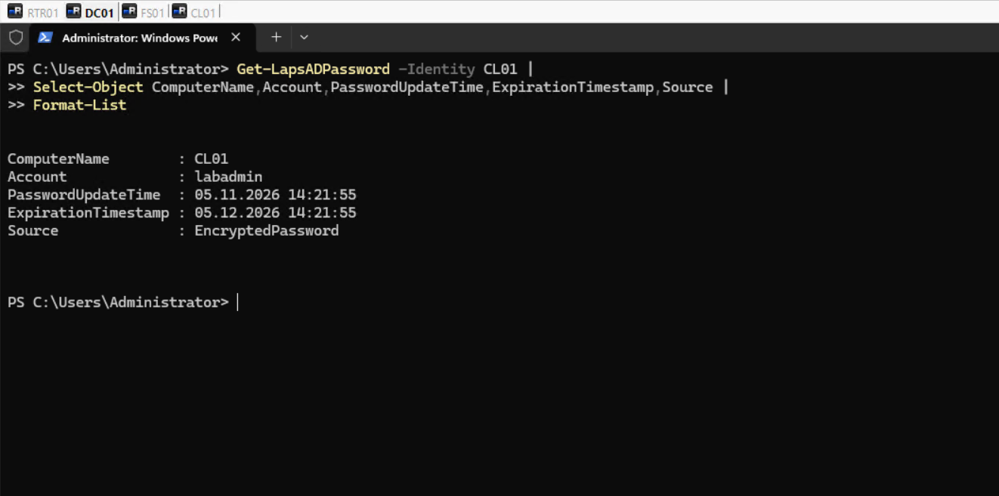
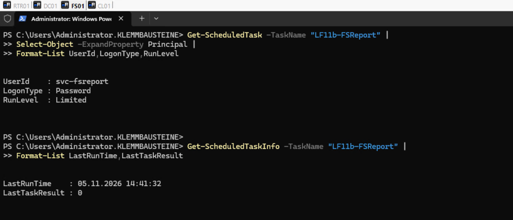
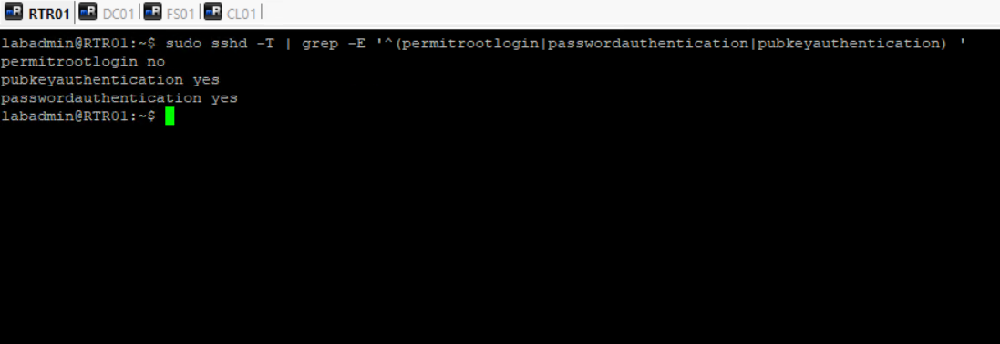

# Systemhärtung und Wirksamkeitsprüfung

## Ziel

Überprüfung und Härtung der bestehenden Windows- und Debian-Systeme mit anschließender Funktionskontrolle. Die vorhandene Netzwerkkonfiguration bleibt unverändert.

## Umgebung

| System | Funktion |
| --- | --- |
| DC01 | Active Directory, Gruppenrichtlinien und DNS |
| FS01 | Dateiserver und Auswertungsaufgabe |
| CL01 | Domänenclient |
| RTR01 | Debian-Router mit VLAN-Routing und NAT |

## Umgesetzte Maßnahmen

### Domänenrichtlinien

Die Kennwort- und Kontosperrrichtlinie wurde auf DC01 überprüft: Mindestlänge 8 Zeichen, Kennwortverlauf 5, maximale Gültigkeit 90 Tage, Komplexität aktiviert sowie Kontosperrung nach 5 Fehlversuchen für 15 Minuten. Die zentrale Richtlinie ist auf Domänenebene verknüpft.

### Lokale Administration und Windows LAPS

Die lokalen Administratorgruppen und Konten auf CL01 wurden geprüft. Die vorhandene Richtlinie `GPO-CLIENT-LAPS` wurde konfiguriert und ihre Anwendung mit `gpresult` bestätigt.

| Einstellung | Wert |
| --- | --- |
| Verwaltetes Konto | `labadmin` |
| Sicherungsziel | Active Directory |
| Kennwortlänge | 16 Zeichen |
| Kennwortkomplexität | 4 |
| Kennwortalter | 30 Tage |
| Sicherungsquelle | `EncryptedPassword` |

Die verschlüsselte Kennwortsicherung wurde auf DC01 bestätigt; das Kennwort selbst wurde nicht dokumentiert.

### Dienstkonto auf FS01

Das Domänenkonto `svc-fsreport` wird für die geplante Auswertung verwendet. Die Aufgabe startet mit `RunLevel: Limited` und besitzt die benötigten NTFS-Berechtigungen: Lesen und Ausführen auf Daten- und Skriptverzeichnissen sowie Ändern im Ausgabeverzeichnis.

Auf FS01 wurden die lokale und die RDP-Anmeldung für das Konto über die lokale Sicherheitsrichtlinie verweigert. `SeBatchLogonRight` blieb erhalten. Die Aufgabe wurde danach und nach einer Gruppenrichtlinienaktualisierung erfolgreich ausgeführt (`LastTaskResult: 0`); die Datei `D:\Service\Auswertungen\fsreport.txt` wurde aktualisiert.

### Debian-Router

Auf RTR01 wurden die sudo-Berechtigungen und die effektive SSH-Konfiguration geprüft. Der SSH-Root-Zugang wurde über `/etc/ssh/sshd_config.d/99-hardening.conf` deaktiviert (`PermitRootLogin no`). Die Anmeldung von `labadmin` über die bestehende Remoteverwaltung blieb funktionsfähig. `PasswordAuthentication` blieb für diesen Zugang aktiviert.

Der negative SSH-Test mit dem Konto `root` wurde abgewiesen. Die aktiven Dienste und Ports sowie die bestehenden nftables- und NAT-Regeln wurden geprüft; Routing und NAT wurden nicht verändert.

### Auditing, Dienste und Versionsstand

- Windows-Anmeldeereignisse werden protokolliert; auf DC01 wurden erfolgreiche Anmeldungen mit Ereignis-ID `4624` nachgewiesen.
- Auf FS01 liefen `LanmanServer`, `WinRM` und `TermService` bei der Prüfung.
- FS01: Windows Server 2025 Standard Evaluation, Build 26100; die beiden geprüften Neustartindikatoren waren nicht gesetzt.
- RTR01: Debian 13 (trixie), Kernel `6.12.113+deb13-amd64`; verfügbare Aktualisierungen für `hyperv-daemons` und `linux-image-amd64` wurden erfasst. Ein Neustart war nicht angefordert.

## Wirksamkeitsprüfung

| Prüfung | Ergebnis |
| --- | --- |
| GPO-Anwendung auf CL01 | Erfolgreich, einschließlich `GPO-CLIENT-LAPS` |
| Verschlüsselte LAPS-Sicherung | Bestätigt |
| Auswertungsaufgabe auf FS01 | Erfolgreich, Rückgabewert `0` |
| SMB-Erreichbarkeit von FS01 | TCP 445 erreichbar |
| SSH-Anmeldung `labadmin` | Nach Konfigurationsänderung erfolgreich |
| SSH-Anmeldung `root` | Abgewiesen |
| Windows-Anmeldeprotokollierung | Ereignis-ID `4624` nachgewiesen |

## Sicherung und Abschluss

Am 05.11.2026 wurden Hyper-V-Checkpoints mit dem Namen `Härtung-2026-11-05` für RTR01, DC01, FS01 und CL01 erstellt und anschließend überprüft.

Die geprüften Funktionen sind weiterhin verfügbar. Die Anmeldebeschränkungen für `svc-fsreport` wurden lokal auf FS01 umgesetzt; eine Übernahme dieser beiden Einstellungen in `GPO-SERVER-BASIS` wurde nicht durchgeführt. Verfügbare Debian-Aktualisierungen wurden erfasst, jedoch nicht installiert.
