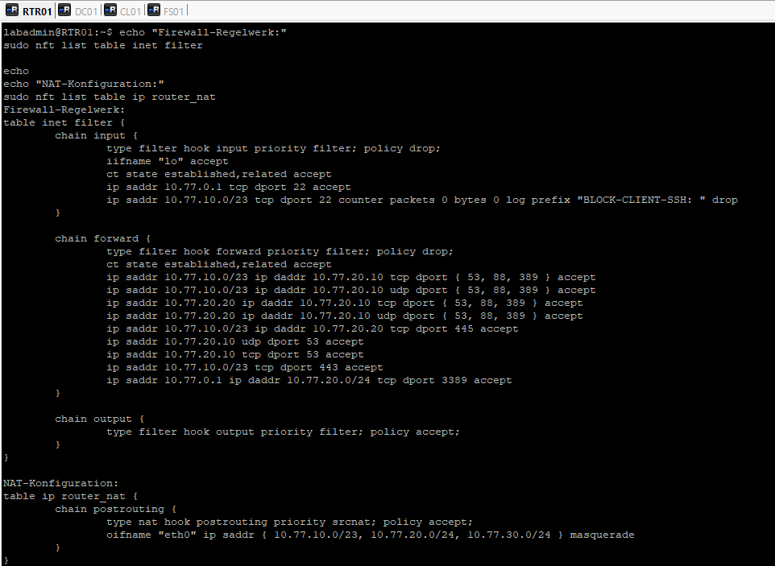
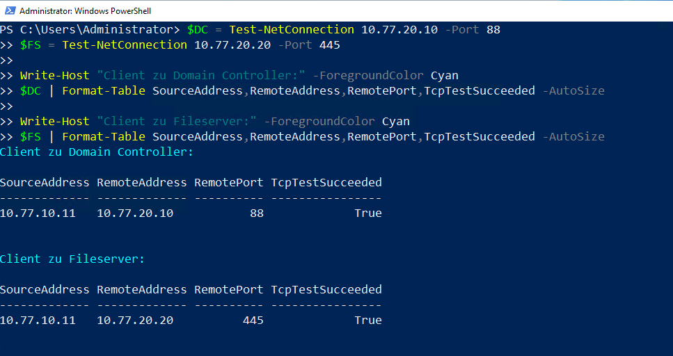
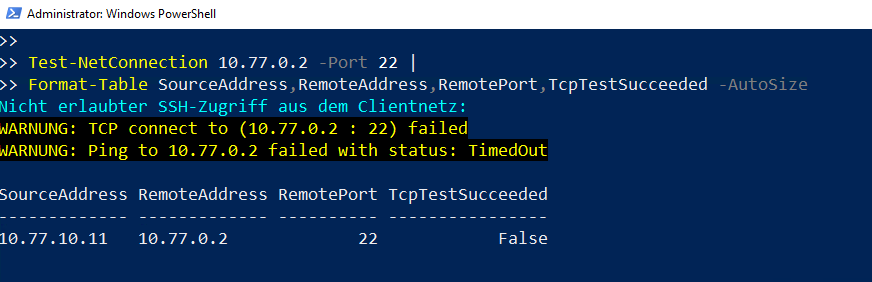
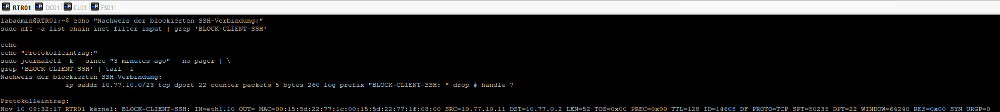

# Netzwerkregelwerk und Wirksamkeitsprüfung

## Ziel

Auf Grundlage der benötigten Kommunikationsbeziehungen wurde ein restriktives Firewall-Regelwerk für den Debian-Router `RTR01` geplant, umgesetzt und geprüft. Die vorhandene VLAN-Struktur und die NAT-Funktion wurden beibehalten. Erlaubte Kernverbindungen bleiben verfügbar, während nicht vorgesehene Verwaltungszugriffe aus dem Clientnetz blockiert werden.

## Systemübersicht

| System | Adresse | Funktion |
|---|---:|---|
| `RTR01` | `10.77.0.2`, `10.77.10.1`, `10.77.20.1`, `10.77.30.1` | Debian-Router, VLAN-Routing, Firewall und NAT |
| `DC01` | `10.77.20.10` | Active Directory, DNS und Gruppenrichtlinien |
| `FS01` | `10.77.20.20` | Dateiserver |
| `CL01` | `10.77.10.11` | Domänenclient |
| Remote-Lab-Host | `10.77.0.1` | Vorgesehener Administrationszugang |

## Kommunikationsmatrix

| Quelle | Ziel | Zweck | Dienst / Port | Vorgabe |
|---|---|---|---|---|
| Clientnetz `10.77.10.0/23` | `DC01` | Domänenanmeldung, Verzeichnisdienst und Namensauflösung | DNS `53`, Kerberos `88`, LDAP `389`, TCP/UDP | Erlauben |
| `FS01` | `DC01` | Domänenauthentifizierung und Namensauflösung | DNS `53`, Kerberos `88`, LDAP `389`, TCP/UDP | Erlauben |
| Clientnetz `10.77.10.0/23` | `FS01` | Zugriff auf zentrale Dateifreigaben | SMB `TCP 445` | Erlauben |
| Clientnetz `10.77.10.0/23` | Internet | Zugriff auf externe Webdienste | HTTPS `TCP 443` | Erlauben |
| Remote-Lab-Host `10.77.0.1` | `RTR01` | Router-Administration | SSH `TCP 22` | Erlauben |
| Remote-Lab-Host `10.77.0.1` | Servernetz `10.77.20.0/24` | Windows-Server-Administration | RDP `TCP 3389` | Erlauben |
| Clientnetz `10.77.10.0/23` | `RTR01` | Nicht vorgesehene Router-Administration | SSH `TCP 22` | Blockieren und protokollieren |
| Clientnetz `10.77.10.0/23` | `FS01` | Nicht vorgesehene Server-Administration | RDP `TCP 3389` | Blockieren |

## Planung des Regelwerks

Für die Chains `input` und `forward` wurde `policy drop` verwendet. Dadurch werden Verbindungen nur zugelassen, wenn eine ausdrückliche Freigaberegel vorhanden ist.

- Die `input`-Chain verarbeitet Verbindungen, deren Ziel `RTR01` selbst ist.
- Die `forward`-Chain verarbeitet Verbindungen, die über `RTR01` zu einem anderen System weitergeleitet werden.
- Bereits aufgebaute und zugehörige Verbindungen werden über `ct state established,related accept` zugelassen.
- Der SSH-Zugang zu `RTR01` ist nur vom Remote-Lab-Host `10.77.0.1` erlaubt.
- SSH-Versuche aus dem Clientnetz werden mit dem Präfix `BLOCK-CLIENT-SSH` protokolliert und verworfen.
- Das bestehende Masquerading für die internen Netze bleibt auf `eth0` erhalten.

## Sicherung und Umsetzung

Vor der Änderung wurden die aktive Konfiguration und `/etc/nftables.conf` unter `/root/firewall-backup/` gesichert.

```text
nftables-before-tag6.nft
nftables.conf.before-tag6
```

Das neue Regelwerk wurde zuerst in `/tmp/tag6-nftables.conf` erstellt und mit folgendem Befehl geprüft:

```bash
sudo nft -c -f /tmp/tag6-nftables.conf
```

Die Syntaxprüfung war erfolgreich. Anschließend wurde das Regelwerk aktiviert und nach erfolgreicher Funktionsprüfung nach `/etc/nftables.conf` übernommen. Der Dienst `nftables` ist aktiviert und aktiv.

Während der Prüfung wurde festgestellt, dass `DC01` für die externe DNS-Auflösung ausgehende DNS-Verbindungen benötigt. Deshalb wurden für `10.77.20.10` die Ports `UDP 53` und `TCP 53` ergänzt. Danach funktionierte der HTTPS-Zugriff von `CL01` wieder.

## Aktives Regelwerk



Die Abbildung zeigt die Filterregeln, `policy drop`, die erlaubten Kommunikationsbeziehungen und die weiterhin aktive Masquerading-Regel.

## Funktionsprüfung

### Erlaubte Verbindungen

| Prüfung | Soll | Ergebnis |
|---|---|---|
| `CL01 → DC01`, Kerberos `TCP 88` | Erreichbar | Erfolgreich |
| `CL01 → FS01`, SMB `TCP 445` | Erreichbar | Erfolgreich |
| `CL01 → Internet`, HTTPS `TCP 443` | Erreichbar | Erfolgreich nach Ergänzung der DNS-Regeln für `DC01` |
| Remote-Lab-Host → `RTR01`, SSH `TCP 22` | Erreichbar | Erfolgreich |



### Blockierte Verbindungen

| Prüfung | Soll | Ergebnis |
|---|---|---|
| `CL01 → RTR01`, SSH `TCP 22` | Blockiert | `TcpTestSucceeded: False` |
| `CL01 → FS01`, RDP `TCP 3389` | Blockiert | `TcpTestSucceeded: False` |



Die SSH-Blockierungsregel erfasste fünf Pakete mit insgesamt 260 Bytes. Der Kernel-Logeintrag bestätigte den Quellhost `10.77.10.11`, das Ziel `10.77.0.2` und den Zielport `22`.



## Persistenzprüfung

Nach `systemctl reload nftables` war der Dienst weiterhin `active`. Die ergänzten DNS-Regeln, die HTTPS-Regel und die NAT-Tabelle waren weiterhin vorhanden. Die Konfiguration ist damit für das erneute Laden vorbereitet.

## Sicherung des Arbeitsstands

Für die vier virtuellen Systeme wurden Hyper-V-Checkpoints mit dem Namen `Netzwerkregelwerk-2026-11-10` erstellt:

| Virtuelles System | Erstellungszeit |
|---|---|
| `RTR01` | 10.11.2026, 09:23:58 |
| `DC01` | 10.11.2026, 09:24:20 |
| `FS01` | 10.11.2026, 09:24:40 |
| `CL01` | 10.11.2026, 09:24:52 |

## Ergebnis

Das Firewall-Regelwerk setzt die dokumentierten Kommunikationsbeziehungen nach dem Prinzip der minimal erforderlichen Freigaben um. Die benötigten Verbindungen für Domänenbetrieb, Dateizugriff, Internetzugriff und Administration funktionieren. Nicht vorgesehene Verwaltungszugriffe aus dem Clientnetz werden blockiert. NAT und Regelwerk bleiben nach einem Reload erhalten, und der geprüfte Stand wurde durch Hyper-V-Checkpoints gesichert.
