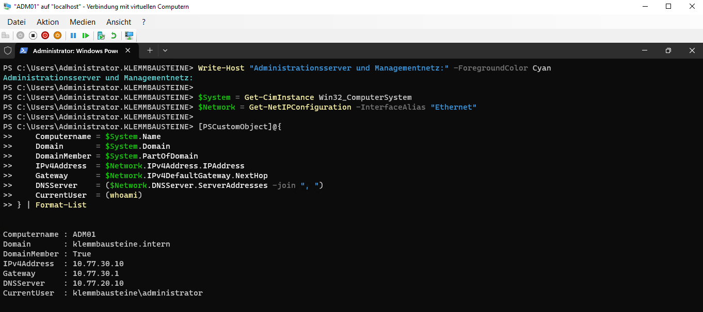
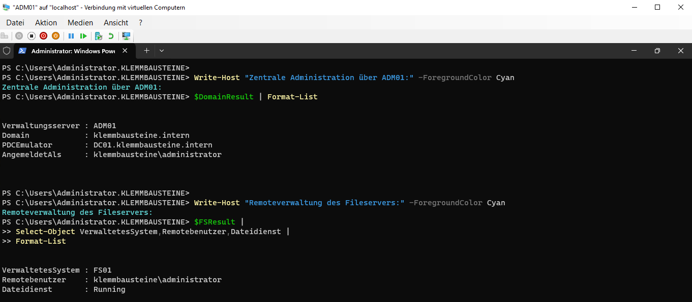
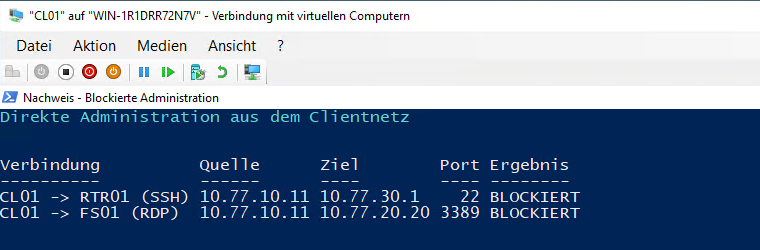
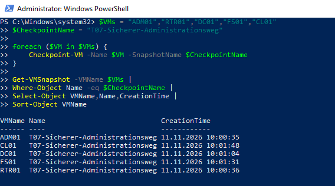

# Sicherer Administrationsweg und Managementnetz

## Ziel

Für die zentrale Administration wurde ein eigener Windows-Administrationsserver im vorbereiteten Managementnetz bereitgestellt. Administrative Zugriffe auf Router, Domaincontroller und Fileserver erfolgen über diesen Server. Direkte Verwaltungszugriffe aus dem Clientnetz bleiben blockiert. Als unabhängiger Wiederherstellungsweg steht Hyper-V VMConnect zur Verfügung.

## Systemübersicht

| System | Adresse | Funktion |
|---|---:|---|
| `ADM01` | `10.77.30.10/24` | Zentraler Windows-Administrationsserver |
| `RTR01` | `10.77.30.1/24` | Gateway des Managementnetzes, Router und Firewall |
| `DC01` | `10.77.20.10/24` | Active Directory, DNS und Gruppenrichtlinien |
| `FS01` | `10.77.20.20/24` | Dateiserver |
| `CL01` | `10.77.10.11/23` | Domänenclient ohne direkten Administrationszugang |

## Managementnetz und Administrationsserver

`ADM01` wurde als virtuelle Maschine der zweiten Generation auf `vSW-LAB` erstellt und dem Access-VLAN 30 zugeordnet. Als Betriebssystem wurde Windows Server 2025 mit grafischer Oberfläche installiert.

| Einstellung | Wert |
|---|---|
| Hostname | `ADM01` |
| IPv4-Adresse | `10.77.30.10/24` |
| Standardgateway | `10.77.30.1` |
| DNS-Server | `10.77.20.10` |
| Domäne | `klemmbausteine.intern` |
| VLAN | `30` |
| Startspeicher | `2 GB` |
| Dynamischer Arbeitsspeicher | Aktiviert, `1–4 GB` |
| Virtuelle Prozessoren | `2` |



## Verwaltungswerkzeuge

Auf `ADM01` sind die erforderlichen Remote Server Administration Tools installiert:

- `RSAT-AD-Tools` für Active Directory
- `RSAT-DNS-Server` für DNS
- `RSAT-File-Services` für Dateidienste

Der Zugriff auf Active Directory wurde mit `Get-ADDomain` geprüft. Dabei wurden die Domäne `klemmbausteine.intern`, der NetBIOS-Name `KLEMMBAUSTEINE` und `DC01.klemmbausteine.intern` als PDC-Emulator erfolgreich ermittelt.

Die Remoteverwaltung von `FS01` wurde über PowerShell Remoting geprüft. Der Befehl wurde auf `FS01` mit dem Domänenkonto `KLEMMBAUSTEINE\Administrator` ausgeführt; die Dateiserver-Dienstfunktion `LanmanServer` war aktiv.



## Firewall-Regeln

Für `ADM01` wurden gezielte Regeln im Regelwerk von `RTR01` ergänzt. Die Regeln sind in `/etc/nftables.d/admin-management.nft` gespeichert und werden über `/etc/nftables.conf` geladen.

### Routerverwaltung

```nft
add rule inet filter input ip saddr 10.77.30.10 tcp dport 22 accept
```

Die Regel erlaubt SSH von `ADM01` zu `RTR01`.

### Verwaltung des Domaincontrollers

Für `DC01` wurden die benötigten Dienste freigegeben, darunter DNS, Kerberos, RPC, LDAP, SMB, Global Catalog, RDP, WinRM, Dynamic RPC und Active Directory Web Services auf `TCP 9389`.

### Verwaltung des Fileservers

Für `FS01` wurden RPC, SMB, RDP, WinRM und Dynamic RPC von `ADM01` zugelassen. Auf `FS01` wurde zusätzlich eine lokale Windows-Firewallregel erstellt, die `WinRM HTTP / TCP 5985` ausschließlich von `10.77.30.10` erlaubt.

Nach einem Reload von `nftables` blieben die Regeln aktiv. Die zunächst doppelte Regel für `TCP 9389` wurde bereinigt und anschließend nur einmal geladen.

## Wirksamkeitsprüfung

### Zulässige Administration

| Quelle | Ziel | Verfahren | Ergebnis |
|---|---|---|---|
| `ADM01` | `RTR01` | SSH `TCP 22` mit `labadmin` | Erfolgreich |
| `ADM01` | `DC01` | RSAT / ADWS `TCP 9389` | Erfolgreich |
| `ADM01` | `DC01` | RDP `TCP 3389` | Erreichbar |
| `ADM01` | `FS01` | PowerShell Remoting / WinRM `TCP 5985` | Erfolgreich |
| `ADM01` | `FS01` | RDP `TCP 3389` | Erreichbar |

### Blockierte direkte Administration

| Quelle | Ziel | Verfahren | Ergebnis |
|---|---|---|---|
| `CL01` | `RTR01` | SSH `TCP 22` | Blockiert |
| `CL01` | `FS01` | RDP `TCP 3389` | Blockiert |



## Recovery-Weg

Als unabhängiger Recovery-Weg ist der direkte Zugriff über Hyper-V VMConnect auf dem Remote-Lab-Host verfügbar. Die Systeme `ADM01`, `CL01`, `DC01`, `FS01` und `RTR01` wurden im Zustand `Running / Normaler Betrieb` geprüft.

## Sicherung des Arbeitsstands

Für alle fünf virtuellen Systeme wurden Hyper-V-Checkpoints mit folgendem Namen erstellt:

```text
T07-Sicherer-Administrationsweg
```



## Ergebnis

Der vorgesehene Administrationsweg ist umgesetzt und geprüft. Administrative Tätigkeiten erfolgen zentral über `ADM01` im Managementnetz. Die Verwaltung von Active Directory, Fileserver und Router funktioniert über die vorgesehenen Protokolle. Direkte Verwaltungszugriffe aus dem Clientnetz sind blockiert. Der Recovery-Zugriff über VMConnect bleibt unabhängig vom Managementnetz verfügbar, und der geprüfte Zustand wurde durch Hyper-V-Checkpoints gesichert.
