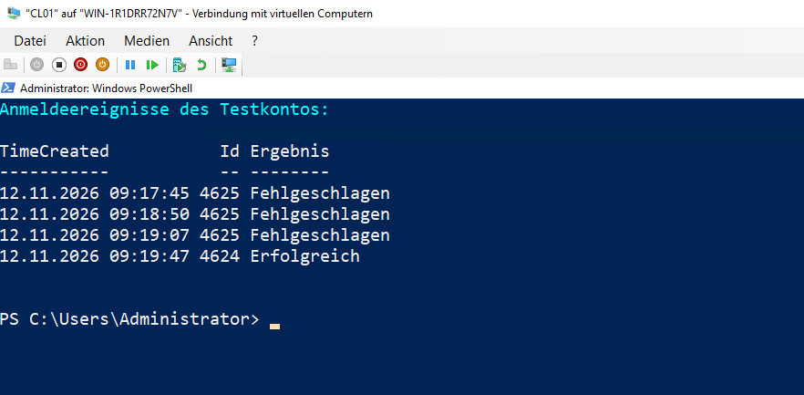
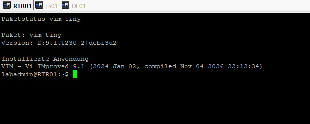
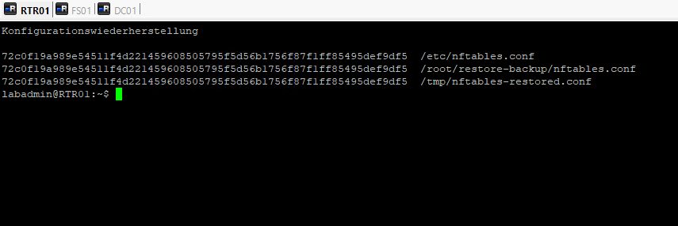
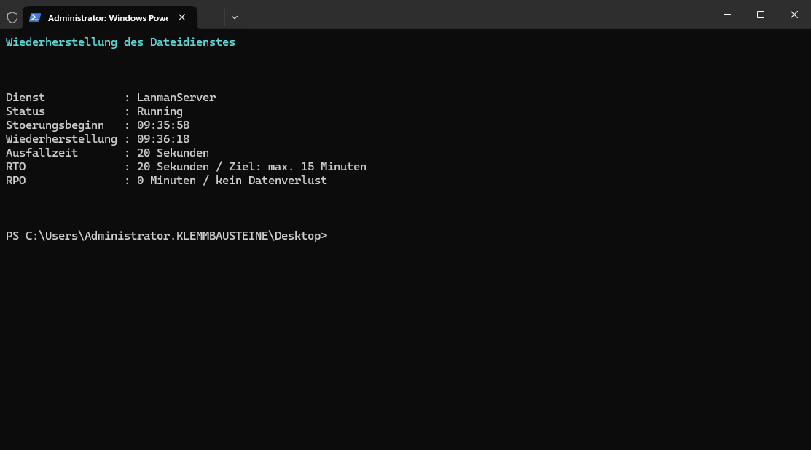

# Betriebsüberwachung, Patchmanagement und Wiederherstellung

## Ziel

Der bestehende Systembetrieb wurde anhand kontrollierter Betriebsfälle für Protokollanalyse, Patchmanagement, Datensicherung, Wiederherstellung und Service-Recovery geprüft. Änderungen wurden auf klar abgegrenzte Testobjekte beschränkt. Produktivdaten sowie die bestehende Netzwerkstruktur blieben unverändert.

## Ausgangslage

Als Ausgangsstand stand der zuvor gesicherte Hyper-V-Zustand `T07-Sicherer-Administrationsweg` für `ADM01`, `CL01`, `DC01`, `FS01` und `RTR01` zur Verfügung.

Für die Betriebsprüfung wurden vier Fälle bearbeitet:

| Bereich | System | Zweck |
|---|---|---|
| Protokollanalyse | `CL01`, `DC01`, `RTR01` | Anmeldeereignisse erfassen und zeitlich einordnen |
| Patchmanagement | `RTR01` | Kleines, nicht kernelbezogenes Paket kontrolliert aktualisieren |
| Backup und Restore | `FS01`, `RTR01` | Datei und Konfiguration sichern und Wiederherstellbarkeit prüfen |
| Service-Recovery | `FS01` | Dateidienst kontrolliert unterbrechen und wiederherstellen |

## Protokollanalyse

Für das Testkonto `KLEMMBAUSTEINE\\tst-technik` wurden kontrollierte Windows-Anmeldeereignisse erzeugt. Im Security-Log von `CL01` waren fehlgeschlagene Anmeldungen mit Ereignis-ID `4625` sowie eine erfolgreiche Anmeldung mit Ereignis-ID `4624` nachvollziehbar.



Auf `DC01` wurden zugehörige Kerberos-Ereignisse für das Testkonto geprüft. Auf `RTR01` wurden fehlgeschlagene und erfolgreiche SSH-Anmeldungen von `ADM01` im systemd-Journal ausgewertet.

Aus den relevanten Ereignissen wurde folgende Zeitlinie gebildet:

| Zeitpunkt | System | Ereignis |
|---|---|---|
| 09:17:45 | `CL01` | Windows-Anmeldung fehlgeschlagen, Event-ID `4625` |
| 09:18:50 | `CL01` | Windows-Anmeldung fehlgeschlagen, Event-ID `4625` |
| 09:19:47 | `CL01` | Windows-Anmeldung erfolgreich, Event-ID `4624` |
| 09:20:46 | `RTR01` | SSH-Anmeldung für `labadmin` fehlgeschlagen |
| 09:21:25 | `RTR01` | SSH-Anmeldung für `labadmin` erfolgreich |

Für die wiederkehrende Betriebsüberwachung wurden drei Prüfbereiche festgelegt:

1. Fehlgeschlagene Windows-Anmeldungen anhand von Event-ID `4625`.
2. Kerberos-Authentifizierungsereignisse auf `DC01`, insbesondere `4768` und `4771`.
3. Fehlgeschlagene und erfolgreiche SSH-Anmeldungen auf `RTR01` über `journalctl -u ssh`.

Die ausgewerteten Ereignisse gehören zu einem kontrolliert erzeugten Testfall und wurden nicht als produktiver Sicherheitsvorfall bewertet.

## Kontrolliertes Paketupdate

Auf `RTR01` wurden zunächst ausschließlich verfügbare Paketaktualisierungen ermittelt. Für den Test wurde `vim-tiny` als kleines, nicht kernelbezogenes Paket ausgewählt.

Vor der Aktualisierung war folgende Version installiert:

```text
vim-tiny 2:9.1.1230-2+deb13u1
```

Aktualisiert wurde ausschließlich `vim-tiny` mit `apt install --only-upgrade vim-tiny`. Die abhängige Komponente `vim-common` wurde durch APT automatisch mit aktualisiert. Ein vollständiges `apt upgrade` und ein Kernel-Update wurden nicht ausgeführt.

Nach der Aktualisierung:

```text
vim-tiny 2:9.1.1230-2+deb13u2
VIM - Vi IMproved 9.1
```



Die installierte Paketversion und die grundlegende Programmfunktion wurden anschließend erfolgreich geprüft.

## Datei-Backup und Restore

Auf `FS01` wurde ausschließlich für den Restore-Test die Datei

```text
D:\Restore-Test\testdatei.txt
```

angelegt. Vor der Sicherung wurde folgende SHA-256-Prüfsumme ermittelt:

```text
EB293310F57094F77B7947C1D32A0A227CF9C50C130D4199A0DC5E7C99B00334
```

Die Sicherung erfolgte nach:

```text
D:\Restore-Backup\testdatei.txt
```

Anschließend wurde ausschließlich die Testdatei aus dem ursprünglichen Verzeichnis entfernt und aus dem Backup wiederhergestellt. Die SHA-256-Prüfsumme der wiederhergestellten Datei entsprach exakt dem Ausgangswert. Damit wurde die inhaltlich unveränderte Wiederherstellung bestätigt.

## Wiederherstellung der Router-Konfiguration

Die aktive Konfigurationsdatei von `nftables` wurde auf `RTR01` nach

```text
/root/restore-backup/nftables.conf
```

gesichert. Für die Restore-Prüfung wurde daraus die separate Datei

```text
/tmp/nftables-restored.conf
```

erzeugt. Das produktive Regelwerk wurde dabei nicht ersetzt.

Die SHA-256-Prüfsummen von Original, Sicherung und wiederhergestellter Kopie waren identisch:

```text
72c0f19a989e54511f4d221459608505795f5d56b1756f87f1ff85495def9df5
```



Damit wurde die Integrität der Konfigurationssicherung und der wiederhergestellten Kopie bestätigt.

## Kontrollierte Service-Wiederherstellung

Auf `FS01` wurde der Dienst `LanmanServer` kontrolliert beendet. Die virtuelle Maschine blieb in Betrieb und Nutzdaten wurden nicht verändert.

```text
Störungsbeginn:    09:35:58
Wiederherstellung: 09:36:18
Ausfallzeit:       ca. 20 Sekunden
```

Nach dem Start des Dienstes befand sich `LanmanServer` wieder im Zustand `Running`. Die SMB-Kernfunktion wurde über `TCP 445` erfolgreich geprüft.

Die vorgegebenen Wiederherstellungsziele wurden erreicht:

| Kennzahl | Ziel | Ergebnis |
|---|---|---|
| RTO | maximal 15 Minuten | ca. 20 Sekunden |
| RPO | 0 Minuten | kein Datenverlust |



## Sicherung des Arbeitsstands

Nach Abschluss der Betriebs-, Restore- und Recovery-Prüfungen wurde der geprüfte Zustand der virtuellen Systeme als Hyper-V-Checkpoint mit dem Namen

```text
T08-Betrieb-Wiederherstellung
```

gesichert.

## Ergebnis

Die vorgesehenen Betriebsfälle wurden kontrolliert durchgeführt. Windows- und SSH-Anmeldeereignisse konnten ausgewertet und in eine gemeinsame Zeitlinie eingeordnet werden. Das ausgewählte Debian-Paket wurde ohne vollständiges System- oder Kernel-Upgrade aktualisiert und anschließend geprüft. Datei- und Konfigurationssicherungen ließen sich anhand identischer SHA-256-Prüfsummen verifizieren. Die kontrollierte Unterbrechung des Dateidienstes wurde innerhalb von rund 20 Sekunden behoben, ohne Datenverlust und deutlich innerhalb des definierten RTO.
